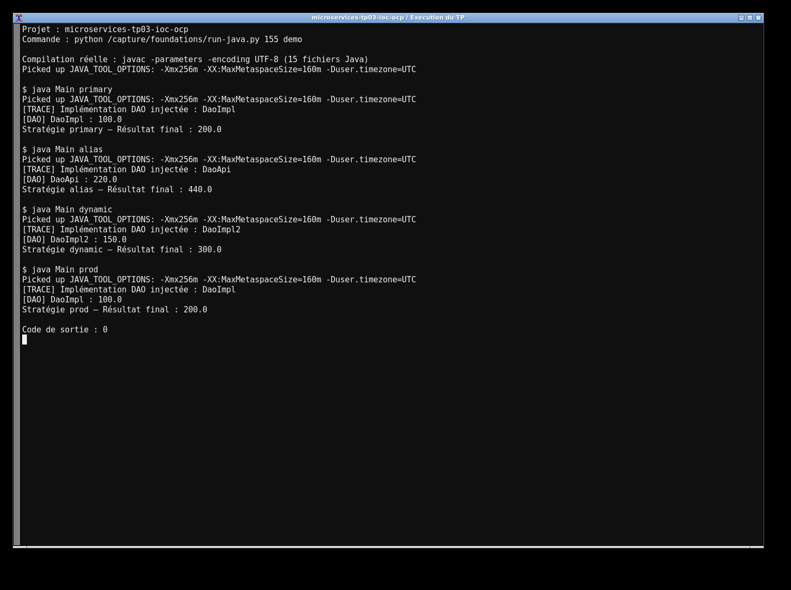
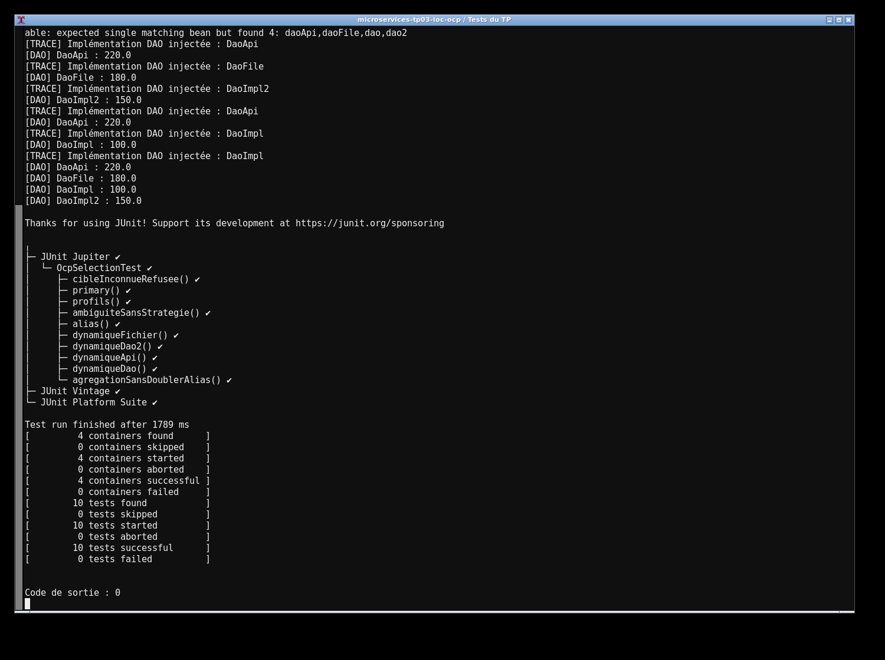

# TP3 — IoC et principe ouvert/fermé

J'ai gardé un seul `MetierImpl`, injecté par constructeur. Les quatre sources du TP retournent 100, 150, 180 et 220. Le choix du DAO est fait dans la configuration Spring 5.3.30 : `@Primary`, alias `@Bean`, propriété externe ou profil. Une trace indique la classe réellement injectée.

J'utilise Java 17 et Maven. Pour lancer le projet :

```sh
mvn clean test
mvn exec:java -Dexec.args=primary
mvn exec:java -Dexec.args=alias
mvn exec:java -Dexec.args=dynamic -Ddao.target=daoApi
```

Les autres profils sont `dev` et `prod`. `DAO_TARGET` peut remplacer `dao.target`. Les tests couvrent les quatre valeurs, le défaut, les alias, les profils, une cible inconnue et l'ambiguïté sans stratégie. `MetierMultiple` montre l'injection d'une liste et d'une map des sources, sans compter les alias deux fois.

Les captures montrent l'exécution réelle du projet et des tests sur ma machine.



